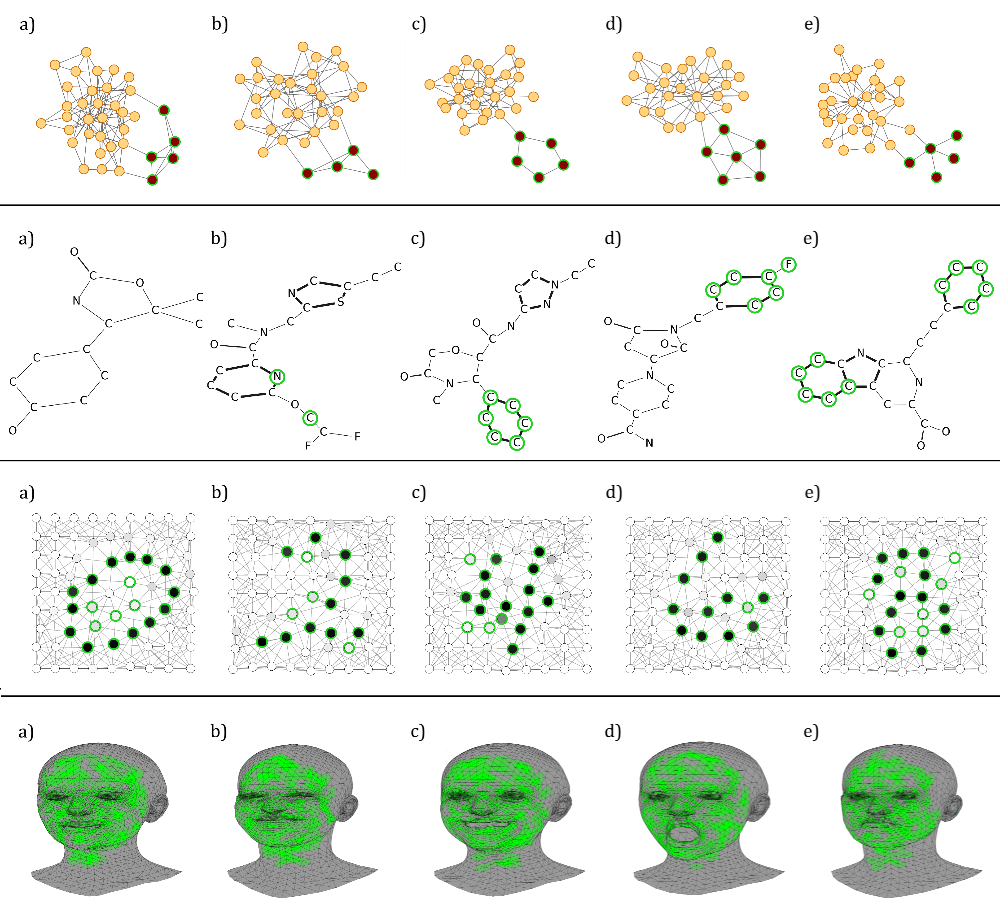
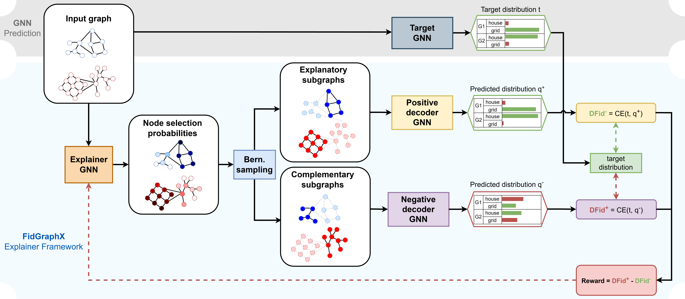

<div align="center">

# FidGraphX

### Distributional Fidelity Optimization for Explaining Graph Neural Network Predictions

**A generative framework for explaining GNN predictions using distributional fidelity.**

[**Overview**](#overview) · [**Visual Explanations**](#visual-explanations) · [**Method**](#how-it-works) · [**Results**](#experimental-results) · [**Getting Started**](#getting-started) · [**Citation**](#citation)

</div>

---

## Overview

FidGraphX is a generative explainer for graph neural networks (GNNs). It identifies compact subgraphs that preserve information about a target prediction and reduce the predictive information in the remaining graph.

The method builds on **distributional fidelity**, which measures how accurately the **target predictive distribution** can be estimated from an explanatory subgraph and its complement. Predictive decoders are trained on these subgraphs, avoiding evaluations of the target GNN on potentially out-of-distribution inputs.

**Main contributions:**

- **Distributional fidelity:** measures agreement with the full predictive distribution.
- **Independent evaluation:** retrains predictive decoders for each explainer under the same protocol.
- **Classification and regression:** applies the same fidelity formulation to categorical and continuous targets.
- **FidGraphX:** optimizes subgraph selection with a REINFORCE-based objective.

## Visual Explanations

<div align="center">
  
</div>

*Explanations produced by FidGraphX (Figure 2 of the manuscript). Rows, from top to bottom: **BA-Motifs** (structural motifs), **Benzene** (molecular substructures), **MNIST75sp** (digit-forming superpixels), and **CoMA** (expression-related facial regions). Green outlines or highlights indicate selected explanatory nodes; for BA-Motifs, dark-red nodes indicate the ground-truth motif.*

The examples cover synthetic motifs, molecular structures, handwritten digits, and facial meshes.

## How It Works

<div align="center">
  
</div>

*FidGraphX training framework (Figure 1 of the manuscript). The target GNN is evaluated on the original graph. An explainer samples an explanatory subgraph and its complement; two predictive decoders reconstruct the target distribution from these components.*

The positive decoder predicts the target distribution from the **selected subgraph**; the negative decoder uses its **complement**. The objective favors subgraphs that preserve target-predictive information and complements that contain less of it.

The dual distributional-fidelity score is

$$
\mathrm{DF} = D_{\mathrm{KL}}(t\parallel q^-) - D_{\mathrm{KL}}(t\parallel q^+)
= \mathrm{CE}(t,q^-) - \mathrm{CE}(t,q^+),
$$

where $t$ is the target distribution and $q^+$ and $q^-$ are the decoder predictions. FidGraphX maximizes this score using stochastic node selection and REINFORCE, with a regularization term controlling explanation size.

During evaluation, **new positive and negative decoders are trained for each fixed explainer** using a common protocol. The training decoders are not reused.

## Experimental Results

We evaluate FidGraphX on synthetic and real-world graph datasets for classification and regression. Selected results from the manuscript are shown below (mean ± standard deviation over five runs).

| Dataset | Task | AUROC ↑ | F1 ↑ |
|:--|:--|--:|--:|
| BA-Motifs | Classification | **0.985 ± 0.007** | **0.888 ± 0.020** |
| BA-HouseXorGrid | Classification | **0.994 ± 0.004** | **0.965 ± 0.003** |
| Benzene | Classification | **0.915 ± 0.012** | **0.812 ± 0.014** |
| MNIST75sp | Classification | **0.947 ± 0.003** | **0.744 ± 0.011** |
| BA-Motifs-Volume | Regression | **0.996 ± 0.003** | **0.907 ± 0.009** |
| BenzeneCount | Regression | **0.947 ± 0.002** | **0.757 ± 0.038** |

*AUROC and F1 measure recovery of ground-truth explanatory nodes, where such annotations are available.*

## Getting Started

### Requirements

- Docker and Docker Compose
- NVIDIA GPU with a compatible driver
- NVIDIA Container Toolkit

### Installation and Execution

1. Clone the repository:

   ```bash
   git clone https://github.com/daniel-unyi-42/FidGraphX.git
   ```

2. Enter the repository:

   ```bash
   cd FidGraphX
   ```

3. Build the Docker image:

   ```bash
   docker compose build
   ```

4. Start the container:

   ```bash
   docker compose up -d
   ```

5. Enter the container:

   ```bash
   docker compose exec fidgraphx bash
   ```

6. Run FidGraphX:

   ```bash
   python main.py
   ```

   Experiment settings can be modified in `config.yaml`.

7. To stop the container, exit the shell and run:

   ```bash
   exit
   docker compose down
   ```

## Citation

If you use FidGraphX or distributional fidelity in your work, please cite the manuscript. The reference will be updated after publication.

```bibtex
@misc{unyi2026fidgraphx,
  title  = {Distributional Fidelity Optimization for Explaining Graph Neural Network Predictions},
  author = {Unyi, Dániel and Tugyi, Beatrix and Gyires-Tóth, Bálint},
  year   = {2026},
  note   = {Manuscript submitted for publication}
}
```

## Acknowledgements

This work was supported by the European Union project **RRF-2.3.1-21-2022-00004** within the Artificial Intelligence National Laboratory. Computational resources were provided by the Komondor supercomputer (KIFÜ) and HUN-REN Cloud.

## License

This project is licensed under the MIT License.
See the [LICENSE](LICENSE) file for details.